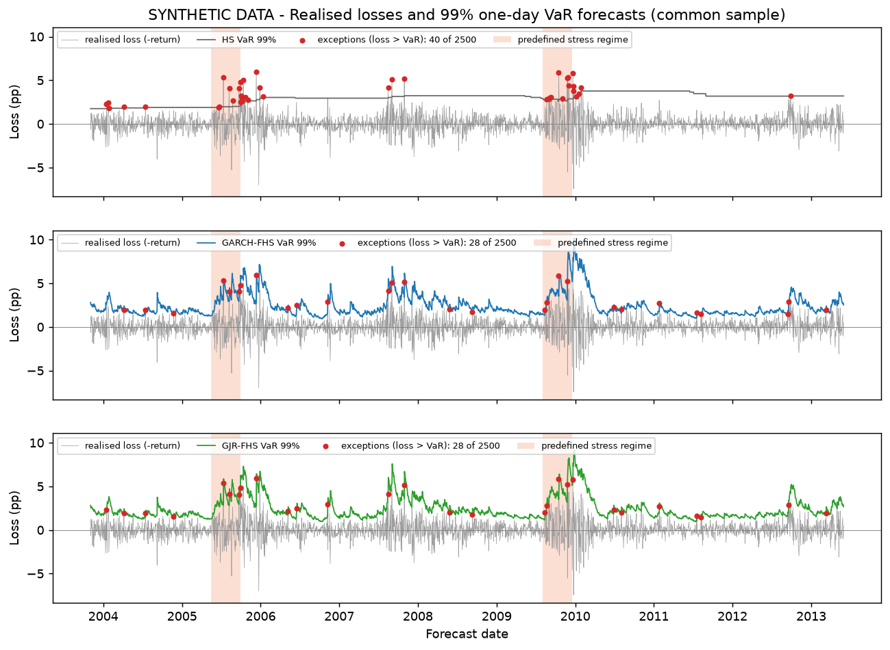
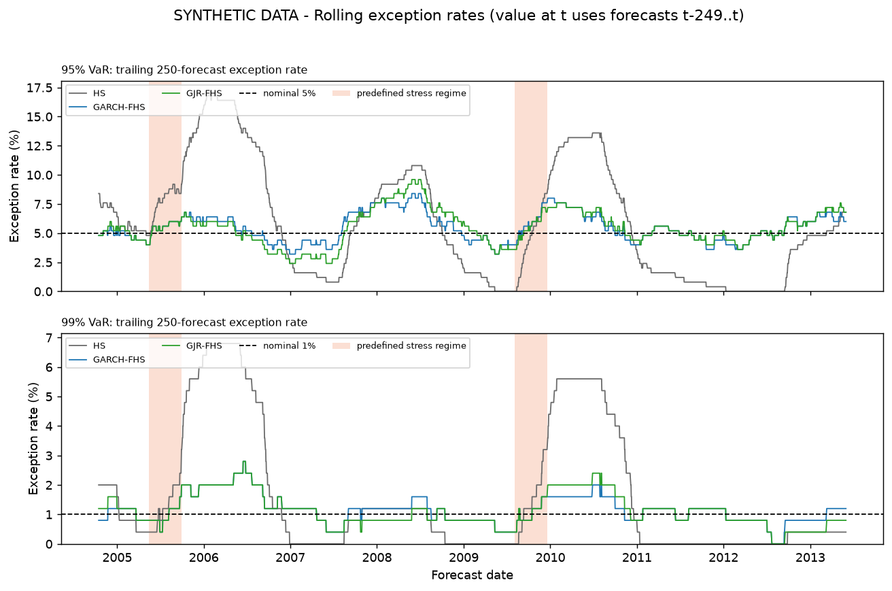
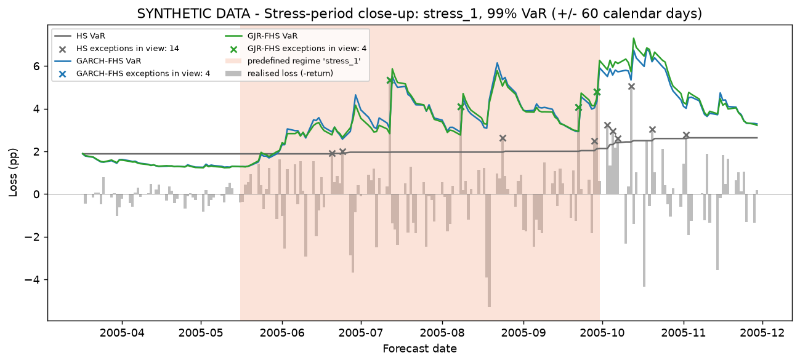

# GARCH Volatility and Filtered Historical Simulation VaR

A small, reproducible Python research project. It compares **plain historical
simulation (HS)** with **GARCH(1,1)-filtered** and **GJR-GARCH(1,1,1)-filtered
historical simulation (FHS)** for one-day-ahead 95% and 99% Value-at-Risk and
Expected Shortfall, using strictly out-of-sample daily refits, formal VaR
coverage tests and predefined stress periods.

## Status

- **Complete**: the offline synthetic baseline. That covers the code, 121
  passing tests, the full 2,500-origin backtest, result files, 8 charts, the
  report and the documentation.
- **Run locally**: the optional SPY market-data example (2,773 forecast
  origins, 2013-12-24 to 2024-12-31). The downloaded prices and the
  `results/market_example/` outputs derived from them are local files and are
  **not** part of the distributable project. Anyone can recreate them with
  the commands below. A written summary is in
  [`docs/market_results.md`](docs/market_results.md).
- The tables in this README are from synthetic data unless they are labelled
  SPY.

## Research question

How do GARCH(1,1)-filtered and GJR-GARCH-filtered historical simulation
compare with plain historical simulation for one-day-ahead VaR and ES,
particularly during changing volatility and stressed periods?

## Models and risk measures

| method | scenarios for day t |
|---|---|
| HS | the previous 1,000 daily losses |
| GARCH-FHS | `σ_t · z_i`, where `z_i` are GARCH-standardised residuals from the previous 1,000 days and `σ_t` is the one-step GARCH forecast |
| GJR-FHS | the same, with a GJR-GARCH filter (extra variance after negative shocks) |

- **VaR** is the empirical ⌈n·c⌉-th order statistic of the losses.
- **ES** is the average of the worst (1−c) probability mass, with fractional
  weight on the boundary loss.
- Losses are negative log returns in percentage points.
- Exceptions are strict (loss > VaR).
- Tests used: Kupiec unconditional coverage, Christoffersen independence and
  conditional coverage, quantile (pinball) loss, and Ljung–Box residual
  diagnostics.

Full specification: [`docs/methodology.md`](docs/methodology.md).

### Third-party components

| component | used for |
|---|---|
| **`arch`** (K. Sheppard) | **Estimates the GARCH/GJR parameters** (Gaussian QML) and produces the one-step variance forecast |
| `statsmodels` | Ljung–Box statistics and autocorrelations |
| `scipy` | χ² p-values and `xlogy` |
| `numpy`, `pandas`, `matplotlib` | arrays, tables and charts |

Implemented in this project:

- the empirical VaR/ES convention, HS and FHS;
- the rolling forecast loop and its no-look-ahead design;
- the coverage-test likelihoods and the metrics;
- the synthetic data generator and the reports.

## Main results (synthetic baseline, 2,500 forecasts)

| model | c | exceptions (expected 125 / 25) | Kupiec p | Christoffersen CC p | mean VaR (pp) | mean ES (pp) | mean quantile loss |
|---|---|---|---|---|---|---|---|
| HS | 95% | 154 | 0.010 | 0.0002 | 1.62 | 2.50 | 0.1325 |
| GARCH-FHS | 95% | 137 | 0.278 | 0.541 | 1.60 | 2.15 | 0.1082 |
| GJR-FHS | 95% | 138 | 0.240 | 0.406 | 1.61 | 2.16 | 0.1081 |
| HS | 99% | 40 | 0.006 | 0.008 | 2.94 | 4.13 | 0.0475 |
| GARCH-FHS | 99% | 28 | 0.554 | 0.610 | 2.45 | 3.16 | 0.0331 |
| GJR-FHS | 99% | 28 | 0.554 | 0.610 | 2.45 | 3.17 | 0.0330 |

What these synthetic results show:

1. **HS versus FHS.** HS fails the coverage tests and has clustered
   exceptions. Both FHS variants are not rejected and have lower quantile
   loss with lower average VaR.
2. **GARCH versus GJR filtering.** The two filters give practically identical
   VaR backtests here, even though GJR tracks the true volatility somewhat
   better outside the stress periods.
3. **Stress periods.** Inside the two 100-day stress regimes (5 expected
   exceptions at 95%), HS had 16 and 21 exceptions and each FHS model had 9
   and 13. So FHS also under-covered at the onset of the abrupt shifts.
4. **After stress.** HS became very conservative, with 1 exception in 435
   post-stress forecasts where about 22 were expected.

The data come from a GJR-type process, which may favour the related filters.
**This is not evidence about real markets.** Details, caveats and the
hypothesis assessment are in [`docs/results.md`](docs/results.md).







The full report and all 8 figures are in
[`results/synthetic_baseline/report.md`](results/synthetic_baseline/report.md).

## Quick start (offline, synthetic)

Requires Python ≥ 3.11. Tested with Python 3.14.4 on Windows 11 (AMD64);
exact package versions are in [`requirements-lock.txt`](requirements-lock.txt).

### Windows PowerShell

```powershell
cd "path\to\GARCH Volatility and Filtered Historical Simulation VaR"
python -m venv .venv
.\.venv\Scripts\Activate.ps1
python -m pip install -e ".[dev]"
python scripts/generate_synthetic_data.py --config configs/synthetic_baseline.json
python scripts/run_backtest.py --config configs/synthetic_baseline.json
python scripts/generate_report.py --results-dir results/synthetic_baseline
```

If script activation is blocked, run
`Set-ExecutionPolicy -Scope Process RemoteSigned` in that session first, or
call `.\.venv\Scripts\python.exe` directly instead of activating.

### macOS / Linux

```bash
cd "path/to/GARCH Volatility and Filtered Historical Simulation VaR"
python3 -m venv .venv
source .venv/bin/activate
python -m pip install -e ".[dev]"
python scripts/generate_synthetic_data.py --config configs/synthetic_baseline.json
python scripts/run_backtest.py --config configs/synthetic_baseline.json
python scripts/generate_report.py --results-dir results/synthetic_baseline
```

To install the exact tested versions instead, run
`python -m pip install -r requirements-lock.txt` and then
`python -m pip install -e . --no-deps`.

### Smoke test (partial, labelled)

```bash
python scripts/run_backtest.py --config configs/synthetic_baseline.json --max-forecasts 60
```

This writes to `results/synthetic_baseline_smoke/`, which is marked
`smoke_test_partial`. It never overwrites the baseline.

## SPY market example (optional, run locally)

| model | c | exceptions (expected) | Kupiec p | Christoffersen IND p | CC p | mean quantile loss |
|---|---|---|---|---|---|---|
| HS | 95% | 142 (138.7) | 0.771 | <0.001 | <0.001 | 0.1377 |
| GARCH-FHS | 95% | 145 (138.7) | 0.583 | 0.116 | 0.249 | 0.1153 |
| GJR-FHS | 95% | 145 (138.7) | 0.583 | 0.875 | 0.847 | 0.1126 |
| HS | 99% | 38 (27.7) | 0.063 | 0.002 | 0.001 | 0.0476 |
| GARCH-FHS | 99% | 31 (27.7) | 0.540 | 0.004 | 0.014 | 0.0351 |
| GJR-FHS | 99% | 29 (27.7) | 0.810 | 0.311 | 0.581 | 0.0345 |

SPY, 2,773 one-day forecasts from 2013-12-24 to 2024-12-31. Data:
Yahoo Finance adjusted closes via `yfinance`, downloaded 2026-11-15.

- No model fails unconditional coverage over the full sample.
- HS exceptions cluster, and HS was breached on 18 of 50 days in the
  COVID-2020 window at 95% (2.5 expected). GARCH-FHS had 7 and GJR-FHS 6.
- In 2022 all three models had more 95% exceptions than expected
  (19–21 vs 12.6).
- GJR-FHS had the lowest quantile loss and no test rejections. GARCH-FHS
  failed the 99% independence test, based on 3 back-to-back exception pairs.

One asset and one period; see [`docs/market_results.md`](docs/market_results.md)
for the details and caveats.

To recreate it:

```bash
python -m pip install -e ".[dev,market]"
python scripts/download_market_data.py --config configs/market_example.json
python scripts/run_backtest.py --config configs/market_example.json
python scripts/generate_report.py --results-dir results/market_example
```

This uses SPY adjusted closes from yfinance (2010-01-01 up to, but not
including, 2025-01-01), with predefined evaluation intervals covering
COVID-2020 and calendar 2022. Downloaded data are **not** included and may
not be redistributable; see [`data/market/README.md`](data/market/README.md).
The exact `yfinance` versions used are in
[`requirements-lock-market.txt`](requirements-lock-market.txt). Yahoo may
revise adjusted prices, so a new download can differ slightly.
You can also supply your own CSV with `date` + `adjusted_close` or
`date` + `return_pct`.

## Testing

```bash
python -m pytest -q
python scripts/run_tests.py --results-dir results/synthetic_baseline   # also saves JUnit XML
```

The recorded run had 121 passed, 0 failed and 0 skipped. Test categories,
hand-calculated checks and leakage tests are described in
[`docs/validation.md`](docs/validation.md).

## Folder structure

```
configs/                 experiment configs (synthetic baseline, optional market example)
data/synthetic/          synthetic returns.csv + metadata.json (generated)
data/market/             instructions only; downloaded data are not included
src/garch_fhs/           package: data, synthetic, volatility, historical, filtered_historical,
                         forecasting, backtesting, diagnostics, metrics, plotting, validation
scripts/                 generate_synthetic_data, download_market_data, run_backtest,
                         generate_report, run_tests
tests/                   pytest suite (121 tests)
docs/                    methodology, results, market_results, validation, learning guide
results/synthetic_baseline/   CSV outputs, run metadata, test XML, report, figures
results/market_example/  local SPY outputs (not distributed; recreate with the commands above)
```

## Assumptions and limitations

- One asset, long position, fixed notional, one-day horizon. No
  square-root-of-time scaling, portfolio optimisation, derivatives or
  trading.
- Zero conditional mean. Gaussian QML estimation, refitted daily on a
  1,000-day window. The FHS tails are empirical, not Gaussian.
- Losses are negative log returns in percentage points. The exact monetary
  loss `N·(1 − e^{r/100})` is available as a utility but is not used in the
  tables.
- The coverage tests use asymptotic χ² p-values, which have limited power at
  99% and in short stress samples. Non-rejection does not prove a model is
  correct.
- ES is reported and compared descriptively. **No formal ES backtest** is
  implemented.
- Synthetic evidence comes from a single simulated path. The GJR-type data
  may favour the GJR and GARCH filters. Market evidence comes from one
  asset (SPY) over one period.
- Many fits reach `arch`'s stationarity constraint (persistence ≈ 1) when a
  stress regime is inside the training window. This is reported in the fit
  diagnostics.
- One dependency is a pre-release (`wrapt 2.6.0.dev1`), pulled in for Python
  3.14 by statsmodels → formulaic.

## References

- Barone-Adesi, G., Giannopoulos, K., & Vosper, L. (1999). VaR without correlations for portfolios of derivative securities. *Journal of Futures Markets*, 19(5), 583–602.
- Bollerslev, T. (1986). Generalized autoregressive conditional heteroskedasticity. *Journal of Econometrics*, 31(3), 307–327.
- Christoffersen, P. F. (1998). Evaluating interval forecasts. *International Economic Review*, 39(4), 841–862.
- Glosten, L. R., Jagannathan, R., & Runkle, D. E. (1993). On the relation between the expected value and the volatility of the nominal excess return on stocks. *Journal of Finance*, 48(5), 1779–1801.
- Hull, J., & White, A. (1998). Incorporating volatility updating into the historical simulation method for value-at-risk. *Journal of Risk*, 1(1), 5–19.
- Kupiec, P. H. (1995). Techniques for verifying the accuracy of risk measurement models. *Journal of Derivatives*, 3(2), 73–84.
- Sheppard, K. *arch*: https://github.com/bashtage/arch, documentation https://arch.readthedocs.io/

Further references are listed in [`docs/methodology.md`](docs/methodology.md).

## Licence

MIT. See [`LICENSE`](LICENSE).

AI assistance was used in developing this project.
