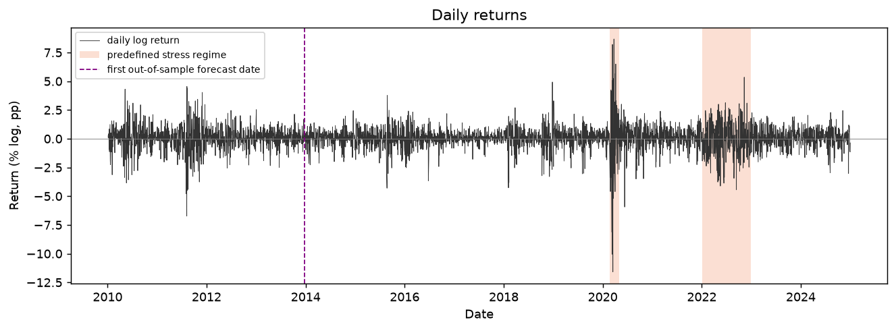
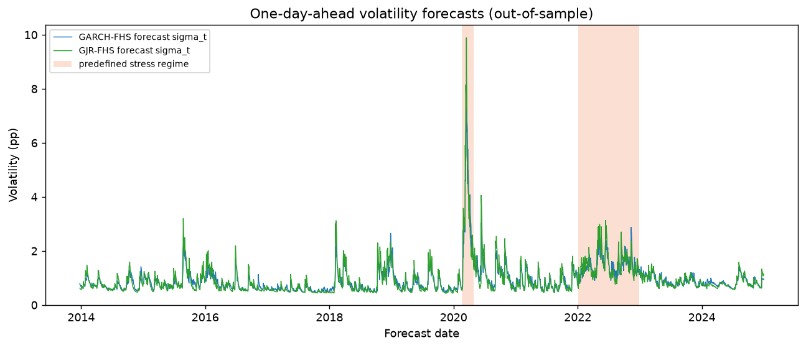
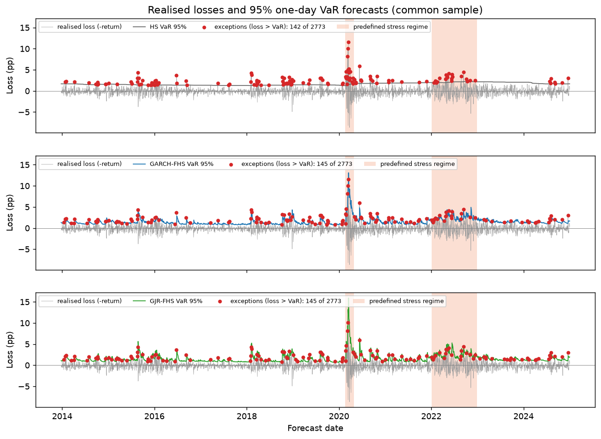
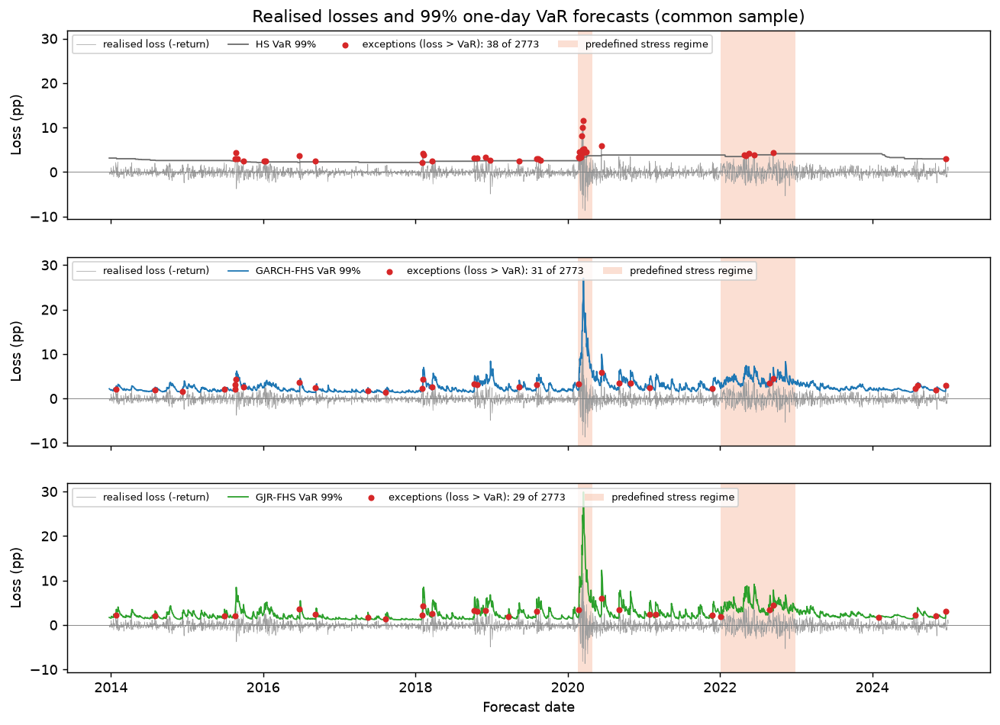
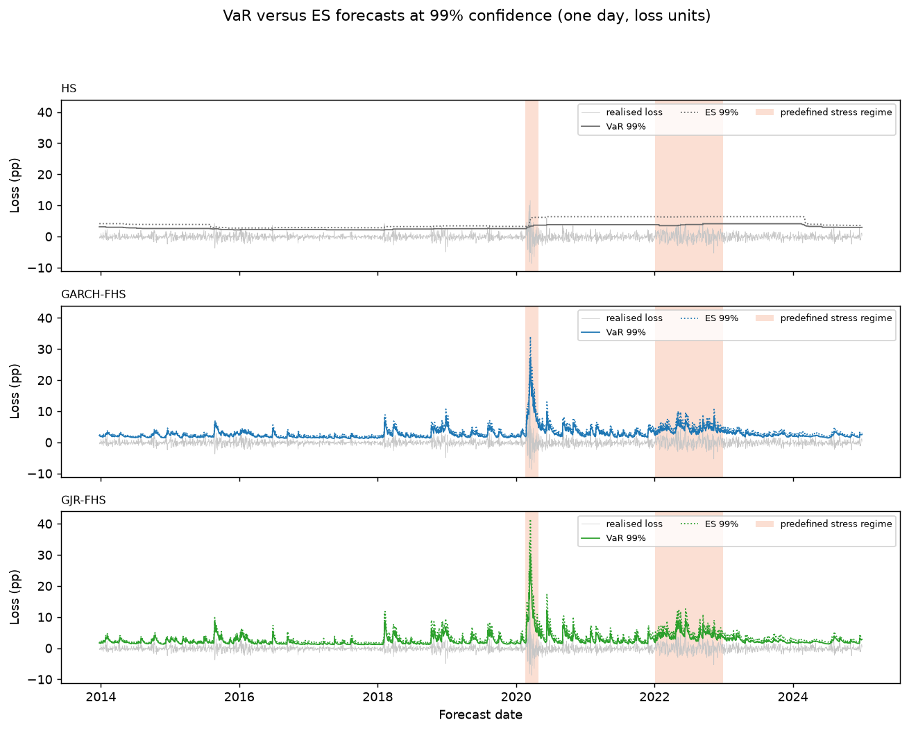
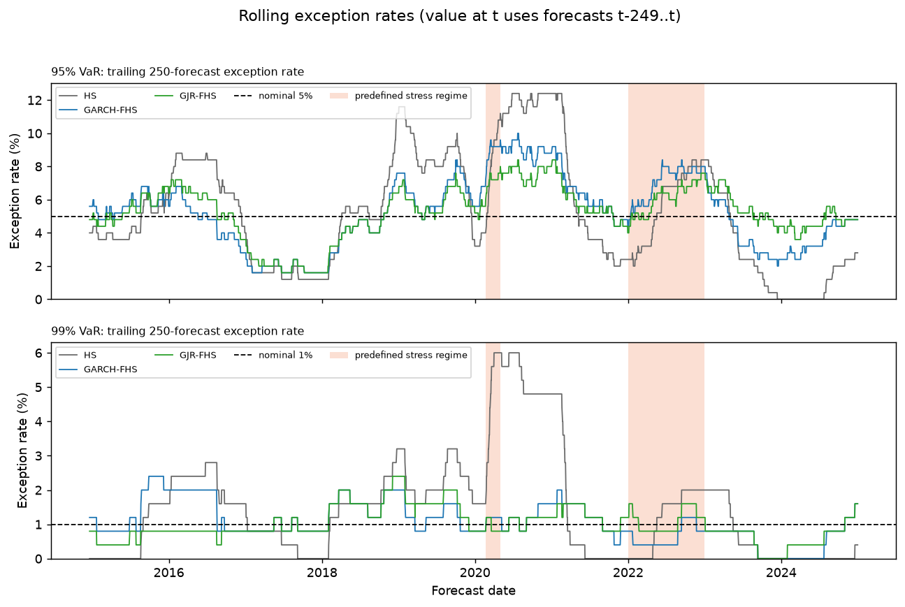
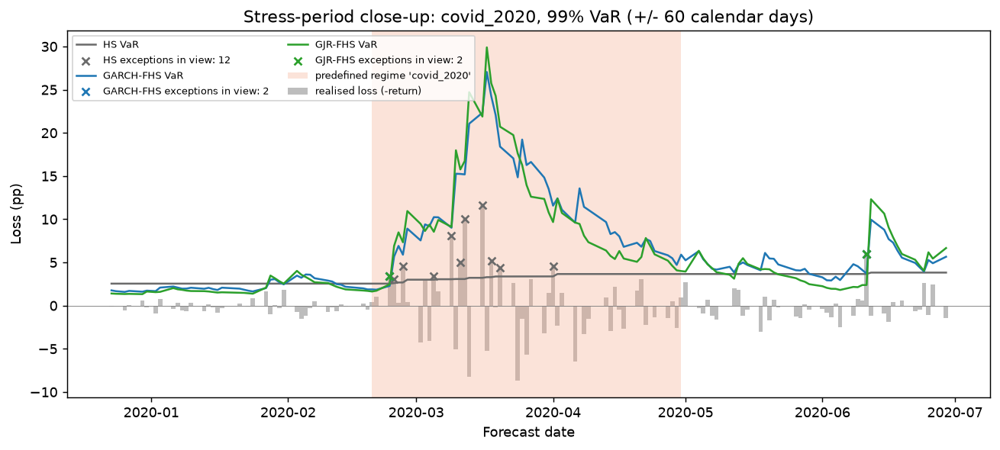
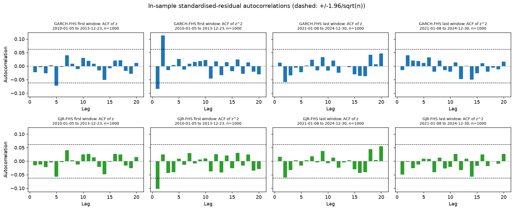

# Backtest report: market example

This report is generated by `scripts/generate_report.py` from the saved files in this folder. It records observed values only; interpretation and caveats are discussed in `docs/results.md`.

## Run

- Run type: `full`; invocation: `python scripts/run_backtest.py --config configs/market_example.json`
- Data: `data/market/spy_daily.csv` (3773 rows, 2010-01-05 to 2024-12-31), SHA-256 `db49baad51cd9a4e...`
- Rolling window: 1000 observations, refit at every origin; minimum residual pool 750
- Forecast origins: 2773 (2013-12-24 to 2024-12-31)
- Common valid sample: 2773 dates; excluded 0 (invalid forecasts by model: none)
- GARCH-FHS fits: 2773, status {'ok': 2773}, retries used 0, fits with warnings 0, persistence range [0.8723, 0.9949], median 0.9540; fits at the stationarity boundary (persistence >= 0.9999): 0
- GJR-FHS fits: 2773, status {'ok': 2773}, retries used 0, fits with warnings 0, persistence range [0.9122, 1.0000], median 0.9683; fits at the stationarity boundary (persistence >= 0.9999): 331
- Python 3.14.4, Windows 11 (AMD64); runtime 61.8 s; finished 2026-11-15T12:47:41Z

## Full common-sample results

| model | c | n | exceptions | expected | exc. rate | mean VaR (pp) | mean ES (pp) | mean excess loss on exc. (pp) | mean quantile loss | max run |
|---|---|---|---|---|---|---|---|---|---|---|
| HS | 0.95 | 2773 | 142 | 138.6500 | 0.0512 | 1.6395 | 2.6303 | 1.0395 | 0.1377 | 4 |
| HS | 0.99 | 2773 | 38 | 27.7300 | 0.0137 | 3.0148 | 4.4315 | 1.2371 | 0.0476 | 2 |
| GARCH-FHS | 0.95 | 2773 | 145 | 138.6500 | 0.0523 | 1.5574 | 2.2876 | 0.6697 | 0.1153 | 3 |
| GARCH-FHS | 0.99 | 2773 | 31 | 27.7300 | 0.0112 | 2.7538 | 3.4639 | 0.6292 | 0.0351 | 3 |
| GJR-FHS | 0.95 | 2773 | 145 | 138.6500 | 0.0523 | 1.5816 | 2.2778 | 0.5939 | 0.1126 | 3 |
| GJR-FHS | 0.99 | 2773 | 29 | 27.7300 | 0.0105 | 2.6262 | 3.5023 | 0.7438 | 0.0345 | 2 |

ES below VaR (should be 0): 0 forecasts.

### Coverage tests (full common sample)

| model | confidence | test | statistic | df | p_value | status | note |
|---|---|---|---|---|---|---|---|
| HS | 0.95 | kupiec_uc | 0.0846 | 1 | 0.7712 | defined |  |
| HS | 0.95 | christoffersen_ind | 22.6737 | 1 | 0.0000 | defined | n00=2510, n01=120, n10=120, n11=22 |
| HS | 0.95 | christoffersen_cc | 22.7608 | 2 | 0.0000 | defined | n00=2510, n01=120, n10=120, n11=22 |
| HS | 0.99 | kupiec_uc | 3.4439 | 1 | 0.0635 | defined |  |
| HS | 0.99 | christoffersen_ind | 10.0208 | 1 | 0.0015 | defined | n00=2700, n01=34, n10=34, n11=4 |
| HS | 0.99 | christoffersen_cc | 13.4722 | 2 | 0.0012 | defined | n00=2700, n01=34, n10=34, n11=4 |
| GARCH-FHS | 0.95 | kupiec_uc | 0.3018 | 1 | 0.5828 | defined |  |
| GARCH-FHS | 0.95 | christoffersen_ind | 2.4745 | 1 | 0.1157 | defined | n00=2494, n01=133, n10=133, n11=12 |
| GARCH-FHS | 0.95 | christoffersen_cc | 2.7812 | 2 | 0.2489 | defined | n00=2494, n01=133, n10=133, n11=12 |
| GARCH-FHS | 0.99 | kupiec_uc | 0.3752 | 1 | 0.5402 | defined |  |
| GARCH-FHS | 0.99 | christoffersen_ind | 8.1169 | 1 | 0.0044 | defined | n00=2713, n01=28, n10=28, n11=3 |
| GARCH-FHS | 0.99 | christoffersen_cc | 8.4945 | 2 | 0.0143 | defined | n00=2713, n01=28, n10=28, n11=3 |
| GJR-FHS | 0.95 | kupiec_uc | 0.3018 | 1 | 0.5828 | defined |  |
| GJR-FHS | 0.95 | christoffersen_ind | 0.0249 | 1 | 0.8746 | defined | n00=2490, n01=137, n10=137, n11=8 |
| GJR-FHS | 0.95 | christoffersen_cc | 0.3316 | 2 | 0.8472 | defined | n00=2490, n01=137, n10=137, n11=8 |
| GJR-FHS | 0.99 | kupiec_uc | 0.0579 | 1 | 0.8099 | defined |  |
| GJR-FHS | 0.99 | christoffersen_ind | 1.0265 | 1 | 0.3110 | defined | n00=2715, n01=28, n10=28, n11=1 |
| GJR-FHS | 0.99 | christoffersen_cc | 1.0853 | 2 | 0.5812 | defined | n00=2715, n01=28, n10=28, n11=1 |

Asymptotic chi-square p-values; they ignore parameter-estimation error from the rolling windows. A non-rejection does not show a model is correct.

### Observed coverage, stated factually

- HS at 95%: 142 exceptions vs 138.7 expected (rate 5.12% vs nominal 5.00%); Kupiec p = 0.771, conditional-coverage p = 0.000.
- HS at 99%: 38 exceptions vs 27.7 expected (rate 1.37% vs nominal 1.00%); Kupiec p = 0.063, conditional-coverage p = 0.001.
- GARCH-FHS at 95%: 145 exceptions vs 138.7 expected (rate 5.23% vs nominal 5.00%); Kupiec p = 0.583, conditional-coverage p = 0.249.
- GARCH-FHS at 99%: 31 exceptions vs 27.7 expected (rate 1.12% vs nominal 1.00%); Kupiec p = 0.540, conditional-coverage p = 0.014.
- GJR-FHS at 95%: 145 exceptions vs 138.7 expected (rate 5.23% vs nominal 5.00%); Kupiec p = 0.583, conditional-coverage p = 0.847.
- GJR-FHS at 99%: 29 exceptions vs 27.7 expected (rate 1.05% vs nominal 1.00%); Kupiec p = 0.810, conditional-coverage p = 0.581.

## Stress and non-stress regimes

| model | c | regime | n | exceptions | expected | exc. rate | mean VaR | mean ES | mean QL | Kupiec p | notes |
|---|---|---|---|---|---|---|---|---|---|---|---|
| GARCH-FHS | 0.95 | normal | 2472 | 118 | 123.6000 | 0.0477 | 1.3831 | 2.0183 | 0.1025 | 0.6027 |  |
| GJR-FHS | 0.95 | normal | 2472 | 120 | 123.6000 | 0.0485 | 1.4012 | 1.9927 | 0.1006 | 0.7386 |  |
| HS | 0.95 | normal | 2472 | 103 | 123.6000 | 0.0417 | 1.5969 | 2.5379 | 0.1130 | 0.0506 |  |
| GARCH-FHS | 0.95 | covid_2020 | 50 | 7 | 2.5000 | 0.1400 | 5.4157 | 8.6456 | 0.4926 | 0.0155 | short sample (<250 obs); expected exceptions < 5: coverage test has very low power |
| GJR-FHS | 0.95 | covid_2020 | 50 | 6 | 2.5000 | 0.1200 | 5.7125 | 8.9799 | 0.4318 | 0.0522 | short sample (<250 obs); expected exceptions < 5: coverage test has very low power |
| HS | 0.95 | covid_2020 | 50 | 18 | 2.5000 | 0.3600 | 1.5086 | 2.8144 | 1.1531 | 0.0000 | short sample (<250 obs); expected exceptions < 5: coverage test has very low power |
| GARCH-FHS | 0.95 | year_2022 | 251 | 20 | 12.5500 | 0.0797 | 2.5053 | 3.6733 | 0.1670 | 0.0462 |  |
| GJR-FHS | 0.95 | year_2022 | 251 | 19 | 12.5500 | 0.0757 | 2.5359 | 3.7510 | 0.1671 | 0.0815 |  |
| HS | 0.95 | year_2022 | 251 | 21 | 12.5500 | 0.0837 | 2.0853 | 3.5040 | 0.1787 | 0.0250 |  |
| GARCH-FHS | 0.95 | all_stress | 301 | 27 | 15.0500 | 0.0897 | 2.9888 | 4.4993 | 0.2211 | 0.0043 | pooled non-contiguous stress regimes |
| GJR-FHS | 0.95 | all_stress | 301 | 25 | 15.0500 | 0.0831 | 3.0636 | 4.6196 | 0.2110 | 0.0158 | pooled non-contiguous stress regimes |
| HS | 0.95 | all_stress | 301 | 39 | 15.0500 | 0.1296 | 1.9895 | 3.3894 | 0.3405 | 0.0000 | pooled non-contiguous stress regimes |
| GARCH-FHS | 0.99 | normal | 2472 | 28 | 24.7200 | 0.0113 | 2.4235 | 3.0231 | 0.0320 | 0.5162 |  |
| GJR-FHS | 0.99 | normal | 2472 | 25 | 24.7200 | 0.0101 | 2.2798 | 3.0159 | 0.0313 | 0.9549 |  |
| HS | 0.99 | normal | 2472 | 22 | 24.7200 | 0.0089 | 2.9272 | 4.2195 | 0.0362 | 0.5753 |  |
| GARCH-FHS | 0.99 | covid_2020 | 50 | 1 | 0.5000 | 0.0200 | 11.2369 | 14.1735 | 0.1312 | 0.5316 | short sample (<250 obs); expected exceptions < 5: coverage test has very low power |
| GJR-FHS | 0.99 | covid_2020 | 50 | 1 | 0.5000 | 0.0200 | 10.8293 | 14.9724 | 0.1234 | 0.5316 | short sample (<250 obs); expected exceptions < 5: coverage test has very low power |
| HS | 0.99 | covid_2020 | 50 | 11 | 0.5000 | 0.2200 | 3.3178 | 5.2515 | 0.6324 | 0.0000 | short sample (<250 obs); expected exceptions < 5: coverage test has very low power |
| GARCH-FHS | 0.99 | year_2022 | 251 | 2 | 2.5100 | 0.0080 | 4.3169 | 5.6723 | 0.0458 | 0.7373 | expected exceptions < 5: coverage test has very low power |
| GJR-FHS | 0.99 | year_2022 | 251 | 3 | 2.5100 | 0.0120 | 4.4041 | 6.0084 | 0.0489 | 0.7630 | expected exceptions < 5: coverage test has very low power |
| HS | 0.99 | year_2022 | 251 | 5 | 2.5100 | 0.0199 | 3.8165 | 6.3563 | 0.0437 | 0.1640 | expected exceptions < 5: coverage test has very low power |
| GARCH-FHS | 0.99 | all_stress | 301 | 3 | 3.0100 | 0.0100 | 5.4664 | 7.0845 | 0.0600 | 0.9954 | expected exceptions < 5: coverage test has very low power; pooled non-contiguous stress regimes |
| GJR-FHS | 0.99 | all_stress | 301 | 4 | 3.0100 | 0.0133 | 5.4714 | 7.4974 | 0.0613 | 0.5851 | expected exceptions < 5: coverage test has very low power; pooled non-contiguous stress regimes |
| HS | 0.99 | all_stress | 301 | 16 | 3.0100 | 0.0532 | 3.7336 | 6.1728 | 0.1415 | 0.0000 | expected exceptions < 5: coverage test has very low power; pooled non-contiguous stress regimes |

Stress samples are short; p-values there have very low power and are shown for completeness only.

## In-sample residual diagnostics (first and last estimation windows)

| model | window | train_start | train_end | diagnostic | lag | statistic | p_value | n |
|---|---|---|---|---|---|---|---|---|
| GARCH-FHS | first | 2010-01-05 | 2013-12-23 | mean |  | 0.0614 | n/a | 1000 |
| GARCH-FHS | first | 2010-01-05 | 2013-12-23 | variance |  | 0.9955 | n/a | 1000 |
| GARCH-FHS | first | 2010-01-05 | 2013-12-23 | skewness |  | -0.3879 | n/a | 1000 |
| GARCH-FHS | first | 2010-01-05 | 2013-12-23 | excess_kurtosis |  | 1.0667 | n/a | 1000 |
| GARCH-FHS | first | 2010-01-05 | 2013-12-23 | ljung_box_z | 10 | 9.2682 | 0.5068 | 1000 |
| GARCH-FHS | first | 2010-01-05 | 2013-12-23 | ljung_box_z | 20 | 14.8852 | 0.7829 | 1000 |
| GARCH-FHS | first | 2010-01-05 | 2013-12-23 | ljung_box_z_squared | 10 | 22.3012 | 0.0136 | 1000 |
| GARCH-FHS | first | 2010-01-05 | 2013-12-23 | ljung_box_z_squared | 20 | 29.4989 | 0.0784 | 1000 |
| GJR-FHS | first | 2010-01-05 | 2013-12-23 | mean |  | 0.0583 | n/a | 1000 |
| GJR-FHS | first | 2010-01-05 | 2013-12-23 | variance |  | 0.9954 | n/a | 1000 |
| GJR-FHS | first | 2010-01-05 | 2013-12-23 | skewness |  | -0.4079 | n/a | 1000 |
| GJR-FHS | first | 2010-01-05 | 2013-12-23 | excess_kurtosis |  | 0.9514 | n/a | 1000 |
| GJR-FHS | first | 2010-01-05 | 2013-12-23 | ljung_box_z | 10 | 6.6920 | 0.7542 | 1000 |
| GJR-FHS | first | 2010-01-05 | 2013-12-23 | ljung_box_z | 20 | 13.0526 | 0.8751 | 1000 |
| GJR-FHS | first | 2010-01-05 | 2013-12-23 | ljung_box_z_squared | 10 | 16.0252 | 0.0989 | 1000 |
| GJR-FHS | first | 2010-01-05 | 2013-12-23 | ljung_box_z_squared | 20 | 25.0164 | 0.2008 | 1000 |
| GARCH-FHS | last | 2021-01-08 | 2024-12-30 | mean |  | 0.0533 | n/a | 1000 |
| GARCH-FHS | last | 2021-01-08 | 2024-12-30 | variance |  | 0.9990 | n/a | 1000 |
| GARCH-FHS | last | 2021-01-08 | 2024-12-30 | skewness |  | -0.4261 | n/a | 1000 |
| GARCH-FHS | last | 2021-01-08 | 2024-12-30 | excess_kurtosis |  | 0.8748 | n/a | 1000 |
| GARCH-FHS | last | 2021-01-08 | 2024-12-30 | ljung_box_z | 10 | 7.5631 | 0.6714 | 1000 |
| GARCH-FHS | last | 2021-01-08 | 2024-12-30 | ljung_box_z | 20 | 16.3570 | 0.6942 | 1000 |
| GARCH-FHS | last | 2021-01-08 | 2024-12-30 | ljung_box_z_squared | 10 | 5.2387 | 0.8747 | 1000 |
| GARCH-FHS | last | 2021-01-08 | 2024-12-30 | ljung_box_z_squared | 20 | 12.0705 | 0.9136 | 1000 |
| GJR-FHS | last | 2021-01-08 | 2024-12-30 | mean |  | 0.0519 | n/a | 1000 |
| GJR-FHS | last | 2021-01-08 | 2024-12-30 | variance |  | 0.9989 | n/a | 1000 |
| GJR-FHS | last | 2021-01-08 | 2024-12-30 | skewness |  | -0.4629 | n/a | 1000 |
| GJR-FHS | last | 2021-01-08 | 2024-12-30 | excess_kurtosis |  | 0.9033 | n/a | 1000 |
| GJR-FHS | last | 2021-01-08 | 2024-12-30 | ljung_box_z | 10 | 7.0167 | 0.7239 | 1000 |
| GJR-FHS | last | 2021-01-08 | 2024-12-30 | ljung_box_z | 20 | 17.4915 | 0.6209 | 1000 |
| GJR-FHS | last | 2021-01-08 | 2024-12-30 | ljung_box_z_squared | 10 | 6.4211 | 0.7787 | 1000 |
| GJR-FHS | last | 2021-01-08 | 2024-12-30 | ljung_box_z_squared | 20 | 13.8035 | 0.8403 | 1000 |

These describe in-sample fit of two windows only; they are not out-of-sample accuracy measures and do not prove that standardised shocks are independent.

## Figures

### Returns with predefined stress shading

### One-step volatility forecasts

### Realised losses, 95% VaR and exceptions

### Realised losses, 99% VaR and exceptions

### VaR and ES at 99% confidence

### Trailing 250-forecast exception rates

### Close-up of the first predefined stress regime (99% VaR)

### Standardised residual and squared-residual autocorrelations

## Limitations

- One asset, one-day horizon, zero conditional mean, Gaussian QML estimation.
- VaR coverage tests are not ES backtests; ES is compared descriptively only.
- 99% VaR has few expected exceptions, so coverage tests have limited power.
