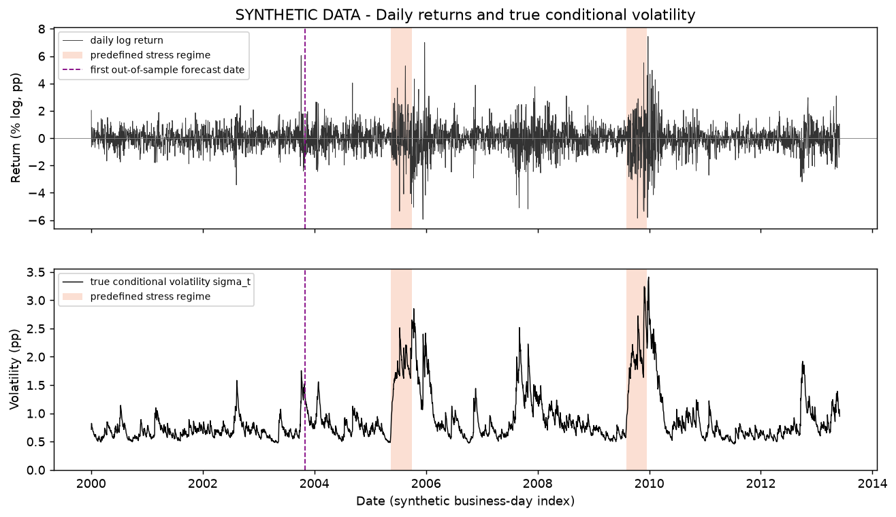
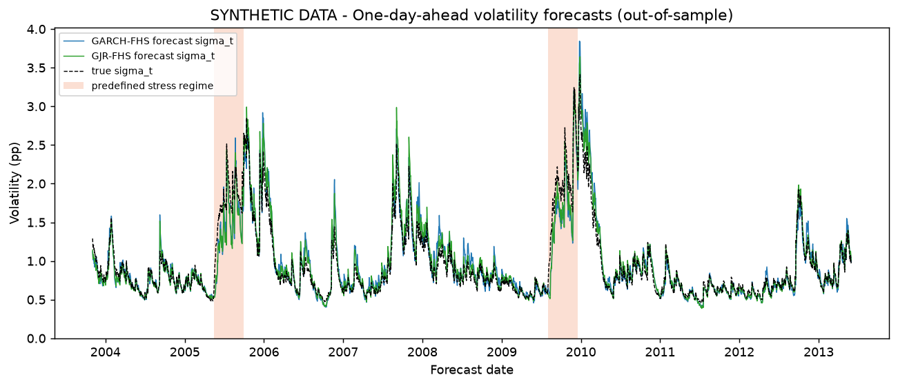
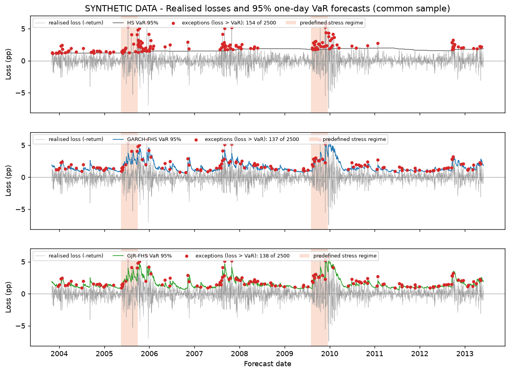
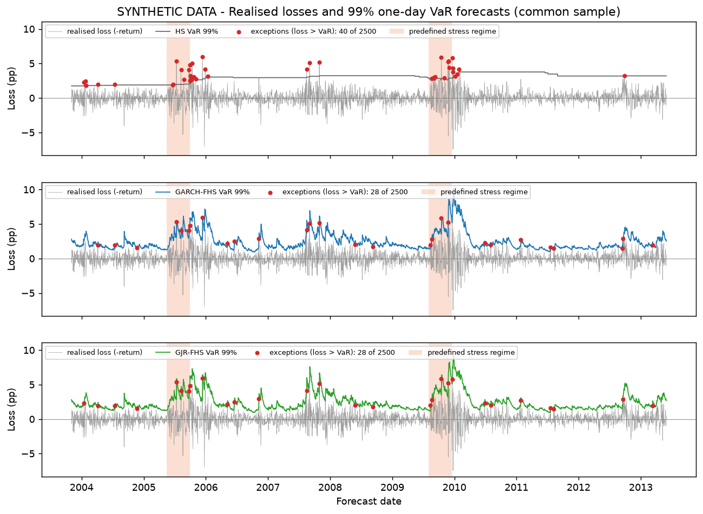
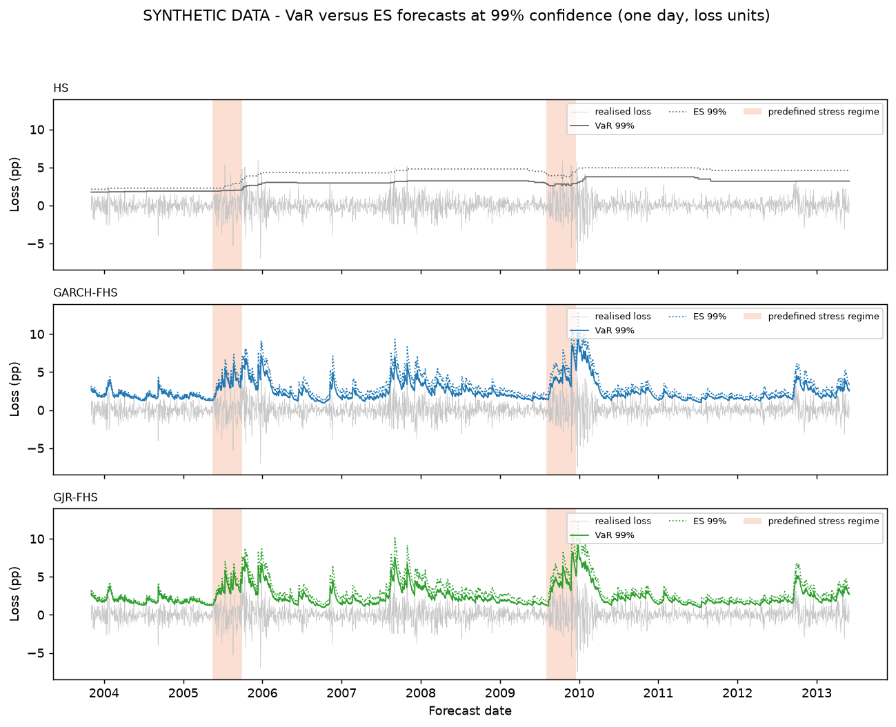
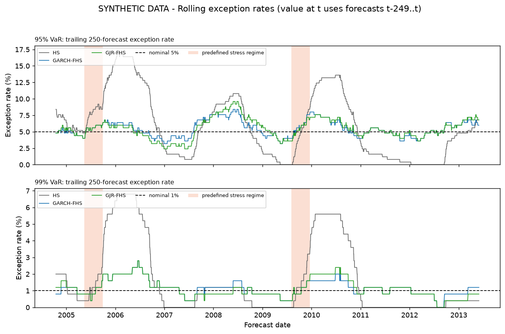
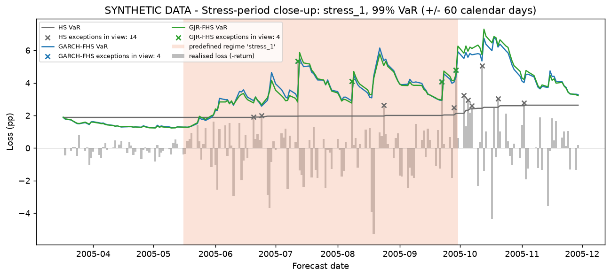
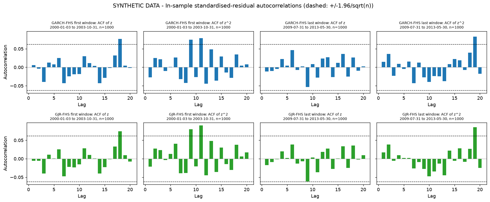

# Backtest report: synthetic baseline

> **SYNTHETIC DATA.** All observations are simulated from a GJR-GARCH Student-t process with predefined stress regimes. Nothing here is market history.

This report is generated by `scripts/generate_report.py` from the saved files in this folder. It records observed values only; interpretation and caveats are discussed in `docs/results.md`.

## Run

- Run type: `full`; invocation: `python scripts/run_backtest.py --config configs/synthetic_baseline.json`
- Data: `data/synthetic/returns.csv` (3500 rows, 2000-01-03 to 2013-05-31), SHA-256 `4df1b68d6be73270...`
- Rolling window: 1000 observations, refit at every origin; minimum residual pool 750
- Forecast origins: 2500 (2003-11-03 to 2013-05-31)
- Common valid sample: 2500 dates; excluded 0 (invalid forecasts by model: none)
- GARCH-FHS fits: 2500, status {'ok': 2500}, retries used 0, fits with warnings 0, persistence range [0.9339, 1.0000], median 0.9920; fits at the stationarity boundary (persistence >= 0.9999): 737
- GJR-FHS fits: 2500, status {'ok': 2500}, retries used 0, fits with warnings 0, persistence range [0.9349, 1.0000], median 0.9897; fits at the stationarity boundary (persistence >= 0.9999): 642
- Python 3.14.4, Windows 11 (AMD64); runtime 52.0 s; finished 2026-11-15T09:37:47Z

## Full common-sample results

| model | c | n | exceptions | expected | exc. rate | mean VaR (pp) | mean ES (pp) | mean excess loss on exc. (pp) | mean quantile loss | max run |
|---|---|---|---|---|---|---|---|---|---|---|
| HS | 0.95 | 2500 | 154 | 125.0000 | 0.0616 | 1.6218 | 2.4954 | 0.8675 | 0.1325 | 5 |
| HS | 0.99 | 2500 | 40 | 25.0000 | 0.0160 | 2.9449 | 4.1328 | 1.1513 | 0.0475 | 2 |
| GARCH-FHS | 0.95 | 2500 | 137 | 125.0000 | 0.0548 | 1.6011 | 2.1519 | 0.5518 | 0.1082 | 2 |
| GARCH-FHS | 0.99 | 2500 | 28 | 25.0000 | 0.0112 | 2.4546 | 3.1587 | 0.8050 | 0.0331 | 1 |
| GJR-FHS | 0.95 | 2500 | 138 | 125.0000 | 0.0552 | 1.6098 | 2.1573 | 0.5369 | 0.1081 | 2 |
| GJR-FHS | 0.99 | 2500 | 28 | 25.0000 | 0.0112 | 2.4499 | 3.1652 | 0.8003 | 0.0330 | 1 |

ES below VaR (should be 0): 0 forecasts.

### Coverage tests (full common sample)

| model | confidence | test | statistic | df | p_value | status | note |
|---|---|---|---|---|---|---|---|
| HS | 0.95 | kupiec_uc | 6.6163 | 1 | 0.0101 | defined |  |
| HS | 0.95 | christoffersen_ind | 10.4166 | 1 | 0.0012 | defined | n00=2211, n01=134, n10=134, n11=20 |
| HS | 0.95 | christoffersen_cc | 17.0575 | 2 | 0.0002 | defined | n00=2211, n01=134, n10=134, n11=20 |
| HS | 0.99 | kupiec_uc | 7.6914 | 1 | 0.0055 | defined |  |
| HS | 0.99 | christoffersen_ind | 1.9325 | 1 | 0.1645 | defined | n00=2421, n01=38, n10=38, n11=2 |
| HS | 0.99 | christoffersen_cc | 9.6360 | 2 | 0.0081 | defined | n00=2421, n01=38, n10=38, n11=2 |
| GARCH-FHS | 0.95 | kupiec_uc | 1.1775 | 1 | 0.2779 | defined |  |
| GARCH-FHS | 0.95 | christoffersen_ind | 0.0397 | 1 | 0.8421 | defined | n00=2232, n01=130, n10=130, n11=7 |
| GARCH-FHS | 0.95 | christoffersen_cc | 1.2274 | 2 | 0.5414 | defined | n00=2232, n01=130, n10=130, n11=7 |
| GARCH-FHS | 0.99 | kupiec_uc | 0.3500 | 1 | 0.5541 | defined |  |
| GARCH-FHS | 0.99 | christoffersen_ind | 0.6346 | 1 | 0.4257 | defined | n00=2443, n01=28, n10=28, n11=0; no consecutive exceptions observed |
| GARCH-FHS | 0.99 | christoffersen_cc | 0.9870 | 2 | 0.6105 | defined | n00=2443, n01=28, n10=28, n11=0; no consecutive exceptions observed |
| GJR-FHS | 0.95 | kupiec_uc | 1.3787 | 1 | 0.2403 | defined |  |
| GJR-FHS | 0.95 | christoffersen_ind | 0.4134 | 1 | 0.5203 | defined | n00=2229, n01=132, n10=132, n11=6 |
| GJR-FHS | 0.95 | christoffersen_cc | 1.8031 | 2 | 0.4059 | defined | n00=2229, n01=132, n10=132, n11=6 |
| GJR-FHS | 0.99 | kupiec_uc | 0.3500 | 1 | 0.5541 | defined |  |
| GJR-FHS | 0.99 | christoffersen_ind | 0.6346 | 1 | 0.4257 | defined | n00=2443, n01=28, n10=28, n11=0; no consecutive exceptions observed |
| GJR-FHS | 0.99 | christoffersen_cc | 0.9870 | 2 | 0.6105 | defined | n00=2443, n01=28, n10=28, n11=0; no consecutive exceptions observed |

Asymptotic chi-square p-values; they ignore parameter-estimation error from the rolling windows. A non-rejection does not show a model is correct.

### Observed coverage, stated factually

- HS at 95%: 154 exceptions vs 125.0 expected (rate 6.16% vs nominal 5.00%); Kupiec p = 0.010, conditional-coverage p = 0.000.
- HS at 99%: 40 exceptions vs 25.0 expected (rate 1.60% vs nominal 1.00%); Kupiec p = 0.006, conditional-coverage p = 0.008.
- GARCH-FHS at 95%: 137 exceptions vs 125.0 expected (rate 5.48% vs nominal 5.00%); Kupiec p = 0.278, conditional-coverage p = 0.541.
- GARCH-FHS at 99%: 28 exceptions vs 25.0 expected (rate 1.12% vs nominal 1.00%); Kupiec p = 0.554, conditional-coverage p = 0.610.
- GJR-FHS at 95%: 138 exceptions vs 125.0 expected (rate 5.52% vs nominal 5.00%); Kupiec p = 0.240, conditional-coverage p = 0.406.
- GJR-FHS at 99%: 28 exceptions vs 25.0 expected (rate 1.12% vs nominal 1.00%); Kupiec p = 0.554, conditional-coverage p = 0.610.

## Stress and non-stress regimes

| model | c | regime | n | exceptions | expected | exc. rate | mean VaR | mean ES | mean QL | Kupiec p | notes |
|---|---|---|---|---|---|---|---|---|---|---|---|
| GARCH-FHS | 0.95 | normal | 2300 | 115 | 115.0000 | 0.0500 | 1.5169 | 2.0456 | 0.0973 | 1.0000 |  |
| GJR-FHS | 0.95 | normal | 2300 | 116 | 115.0000 | 0.0504 | 1.5245 | 2.0493 | 0.0970 | 0.9239 |  |
| HS | 0.95 | normal | 2300 | 117 | 115.0000 | 0.0509 | 1.6346 | 2.5296 | 0.1186 | 0.8487 |  |
| GARCH-FHS | 0.95 | stress_1 | 100 | 9 | 5.0000 | 0.0900 | 2.3971 | 3.0444 | 0.2229 | 0.0972 | short sample (<250 obs) |
| GJR-FHS | 0.95 | stress_1 | 100 | 9 | 5.0000 | 0.0900 | 2.3637 | 3.0042 | 0.2217 | 0.0972 | short sample (<250 obs) |
| HS | 0.95 | stress_1 | 100 | 16 | 5.0000 | 0.1600 | 1.2311 | 1.7053 | 0.2545 | 0.0000 | short sample (<250 obs) |
| GARCH-FHS | 0.95 | stress_2 | 100 | 13 | 5.0000 | 0.1300 | 2.7402 | 3.7040 | 0.2455 | 0.0020 | short sample (<250 obs) |
| GJR-FHS | 0.95 | stress_2 | 100 | 13 | 5.0000 | 0.1300 | 2.8185 | 3.7935 | 0.2498 | 0.0020 | short sample (<250 obs) |
| HS | 0.95 | stress_2 | 100 | 21 | 5.0000 | 0.2100 | 1.7168 | 2.4982 | 0.3291 | 0.0000 | short sample (<250 obs) |
| GARCH-FHS | 0.95 | all_stress | 200 | 22 | 10.0000 | 0.1100 | 2.5686 | 3.3742 | 0.2342 | 0.0007 | short sample (<250 obs); pooled non-contiguous stress regimes |
| GJR-FHS | 0.95 | all_stress | 200 | 22 | 10.0000 | 0.1100 | 2.5911 | 3.3989 | 0.2357 | 0.0007 | short sample (<250 obs); pooled non-contiguous stress regimes |
| HS | 0.95 | all_stress | 200 | 37 | 10.0000 | 0.1850 | 1.4740 | 2.1018 | 0.2918 | 0.0000 | short sample (<250 obs); pooled non-contiguous stress regimes |
| GARCH-FHS | 0.99 | normal | 2300 | 20 | 23.0000 | 0.0087 | 2.3321 | 3.0097 | 0.0285 | 0.5202 |  |
| GJR-FHS | 0.99 | normal | 2300 | 20 | 23.0000 | 0.0087 | 2.3264 | 3.0146 | 0.0281 | 0.5202 |  |
| HS | 0.99 | normal | 2300 | 24 | 23.0000 | 0.0104 | 2.9966 | 4.2064 | 0.0397 | 0.8352 |  |
| GARCH-FHS | 0.99 | stress_1 | 100 | 4 | 1.0000 | 0.0400 | 3.5146 | 4.1449 | 0.0859 | 0.0228 | short sample (<250 obs); expected exceptions < 5: coverage test has very low power |
| GJR-FHS | 0.99 | stress_1 | 100 | 4 | 1.0000 | 0.0400 | 3.4812 | 4.0957 | 0.0876 | 0.0228 | short sample (<250 obs); expected exceptions < 5: coverage test has very low power |
| HS | 0.99 | stress_1 | 100 | 8 | 1.0000 | 0.0800 | 1.9540 | 2.5904 | 0.1348 | 0.0000 | short sample (<250 obs); expected exceptions < 5: coverage test has very low power |
| GARCH-FHS | 0.99 | stress_2 | 100 | 4 | 1.0000 | 0.0400 | 4.2123 | 5.5985 | 0.0875 | 0.0228 | short sample (<250 obs); expected exceptions < 5: coverage test has very low power |
| GJR-FHS | 0.99 | stress_2 | 100 | 4 | 1.0000 | 0.0400 | 4.2599 | 5.6999 | 0.0918 | 0.0228 | short sample (<250 obs); expected exceptions < 5: coverage test has very low power |
| HS | 0.99 | stress_2 | 100 | 8 | 1.0000 | 0.0800 | 2.7472 | 3.9805 | 0.1388 | 0.0000 | short sample (<250 obs); expected exceptions < 5: coverage test has very low power |
| GARCH-FHS | 0.99 | all_stress | 200 | 8 | 2.0000 | 0.0400 | 3.8634 | 4.8717 | 0.0867 | 0.0013 | short sample (<250 obs); expected exceptions < 5: coverage test has very low power; pooled non-contiguous stress regimes |
| GJR-FHS | 0.99 | all_stress | 200 | 8 | 2.0000 | 0.0400 | 3.8706 | 4.8978 | 0.0897 | 0.0013 | short sample (<250 obs); expected exceptions < 5: coverage test has very low power; pooled non-contiguous stress regimes |
| HS | 0.99 | all_stress | 200 | 16 | 2.0000 | 0.0800 | 2.3506 | 3.2854 | 0.1368 | 0.0000 | short sample (<250 obs); expected exceptions < 5: coverage test has very low power; pooled non-contiguous stress regimes |

Stress samples are short; p-values there have very low power and are shown for completeness only.

## Volatility forecasts versus true synthetic volatility

Available only because the synthetic data-generating volatility is known. Not available for market data.

| model | regime | n | rmse_vol_pct | mae_vol_pct | mean_forecast_vol_pct | mean_true_vol_pct | qlike_true_variance |
|---|---|---|---|---|---|---|---|
| GARCH-FHS | all | 2500 | 0.1436 | 0.0915 | 0.9745 | 0.9659 | 0.0277 |
| GJR-FHS | all | 2500 | 0.1239 | 0.0769 | 0.9793 | 0.9659 | 0.0216 |
| GARCH-FHS | normal | 2300 | 0.1141 | 0.0727 | 0.9228 | 0.8877 | 0.0167 |
| GJR-FHS | normal | 2300 | 0.0914 | 0.0589 | 0.9265 | 0.8877 | 0.0094 |
| GARCH-FHS | stress_1 | 100 | 0.3264 | 0.3014 | 1.4729 | 1.7547 | 0.1620 |
| GJR-FHS | stress_1 | 100 | 0.3312 | 0.3096 | 1.4518 | 1.7547 | 0.1622 |
| GARCH-FHS | stress_2 | 100 | 0.3312 | 0.3136 | 1.6649 | 1.9774 | 0.1468 |
| GJR-FHS | stress_2 | 100 | 0.2860 | 0.2573 | 1.7201 | 1.9774 | 0.1616 |

## In-sample residual diagnostics (first and last estimation windows)

| model | window | train_start | train_end | diagnostic | lag | statistic | p_value | n |
|---|---|---|---|---|---|---|---|---|
| GARCH-FHS | first | 2000-01-03 | 2003-10-31 | mean |  | -0.0035 | n/a | 1000 |
| GARCH-FHS | first | 2000-01-03 | 2003-10-31 | variance |  | 1.0055 | n/a | 1000 |
| GARCH-FHS | first | 2000-01-03 | 2003-10-31 | skewness |  | 0.1112 | n/a | 1000 |
| GARCH-FHS | first | 2000-01-03 | 2003-10-31 | excess_kurtosis |  | 1.3096 | n/a | 1000 |
| GARCH-FHS | first | 2000-01-03 | 2003-10-31 | ljung_box_z | 10 | 5.5894 | 0.8485 | 1000 |
| GARCH-FHS | first | 2000-01-03 | 2003-10-31 | ljung_box_z | 20 | 16.4344 | 0.6893 | 1000 |
| GARCH-FHS | first | 2000-01-03 | 2003-10-31 | ljung_box_z_squared | 10 | 11.8138 | 0.2977 | 1000 |
| GARCH-FHS | first | 2000-01-03 | 2003-10-31 | ljung_box_z_squared | 20 | 27.0132 | 0.1349 | 1000 |
| GJR-FHS | first | 2000-01-03 | 2003-10-31 | mean |  | -0.0076 | n/a | 1000 |
| GJR-FHS | first | 2000-01-03 | 2003-10-31 | variance |  | 1.0052 | n/a | 1000 |
| GJR-FHS | first | 2000-01-03 | 2003-10-31 | skewness |  | 0.0979 | n/a | 1000 |
| GJR-FHS | first | 2000-01-03 | 2003-10-31 | excess_kurtosis |  | 1.1804 | n/a | 1000 |
| GJR-FHS | first | 2000-01-03 | 2003-10-31 | ljung_box_z | 10 | 5.9829 | 0.8167 | 1000 |
| GJR-FHS | first | 2000-01-03 | 2003-10-31 | ljung_box_z | 20 | 15.9415 | 0.7202 | 1000 |
| GJR-FHS | first | 2000-01-03 | 2003-10-31 | ljung_box_z_squared | 10 | 13.4968 | 0.1972 | 1000 |
| GJR-FHS | first | 2000-01-03 | 2003-10-31 | ljung_box_z_squared | 20 | 31.2375 | 0.0521 | 1000 |
| GARCH-FHS | last | 2009-07-31 | 2013-05-30 | mean |  | -0.0973 | n/a | 1000 |
| GARCH-FHS | last | 2009-07-31 | 2013-05-30 | variance |  | 0.9901 | n/a | 1000 |
| GARCH-FHS | last | 2009-07-31 | 2013-05-30 | skewness |  | -0.2484 | n/a | 1000 |
| GARCH-FHS | last | 2009-07-31 | 2013-05-30 | excess_kurtosis |  | 1.0371 | n/a | 1000 |
| GARCH-FHS | last | 2009-07-31 | 2013-05-30 | ljung_box_z | 10 | 5.9391 | 0.8204 | 1000 |
| GARCH-FHS | last | 2009-07-31 | 2013-05-30 | ljung_box_z | 20 | 11.7133 | 0.9256 | 1000 |
| GARCH-FHS | last | 2009-07-31 | 2013-05-30 | ljung_box_z_squared | 10 | 6.7994 | 0.7442 | 1000 |
| GARCH-FHS | last | 2009-07-31 | 2013-05-30 | ljung_box_z_squared | 20 | 19.3634 | 0.4983 | 1000 |
| GJR-FHS | last | 2009-07-31 | 2013-05-30 | mean |  | -0.1019 | n/a | 1000 |
| GJR-FHS | last | 2009-07-31 | 2013-05-30 | variance |  | 0.9905 | n/a | 1000 |
| GJR-FHS | last | 2009-07-31 | 2013-05-30 | skewness |  | -0.2582 | n/a | 1000 |
| GJR-FHS | last | 2009-07-31 | 2013-05-30 | excess_kurtosis |  | 0.8896 | n/a | 1000 |
| GJR-FHS | last | 2009-07-31 | 2013-05-30 | ljung_box_z | 10 | 6.3048 | 0.7890 | 1000 |
| GJR-FHS | last | 2009-07-31 | 2013-05-30 | ljung_box_z | 20 | 12.7378 | 0.8883 | 1000 |
| GJR-FHS | last | 2009-07-31 | 2013-05-30 | ljung_box_z_squared | 10 | 5.7005 | 0.8398 | 1000 |
| GJR-FHS | last | 2009-07-31 | 2013-05-30 | ljung_box_z_squared | 20 | 19.3068 | 0.5020 | 1000 |

These describe in-sample fit of two windows only; they are not out-of-sample accuracy measures and do not prove that standardised shocks are independent.

## Figures

Synthetic-data note: the volatility-accuracy table above is the only place where the true data-generating volatility is used; all VaR/ES forecasts use returns only.

### Returns and true conditional volatility with predefined stress shading

### One-step volatility forecasts versus true volatility

### Realised losses, 95% VaR and exceptions

### Realised losses, 99% VaR and exceptions

### VaR and ES at 99% confidence

### Trailing 250-forecast exception rates

### Close-up of the first predefined stress regime (99% VaR)

### Standardised residual and squared-residual autocorrelations

## Limitations

- One asset, one-day horizon, zero conditional mean, Gaussian QML estimation.
- VaR coverage tests are not ES backtests; ES is compared descriptively only.
- 99% VaR has few expected exceptions, so coverage tests have limited power.
- The synthetic process is GJR-GARCH-type, which may favour the related filters; synthetic results are not evidence about real markets.
